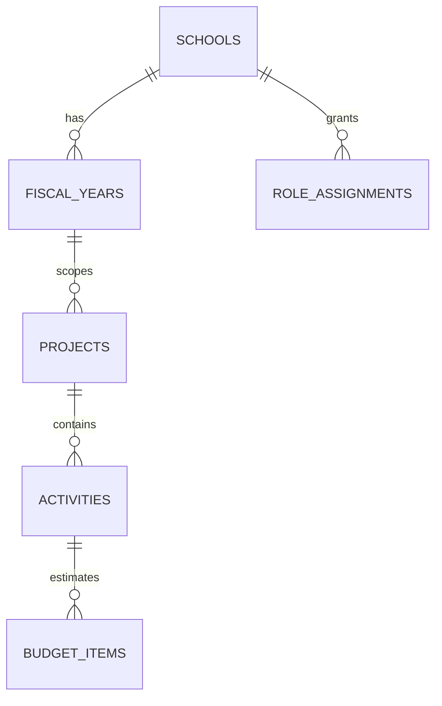
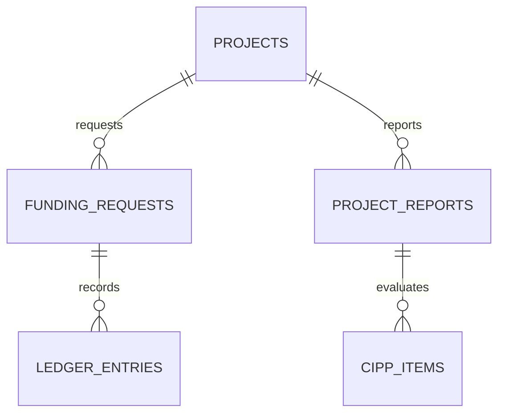

# โครงสร้างฐานข้อมูล

ระบบใช้ PostgreSQL relational rows เป็นข้อมูลหลัก ตารางใน migrations รุ่นนี้รองรับวงจรโครงการ แผนงบ การพิจารณา การจ่าย และรายงาน CIPP ตามขอบเขตที่ทำไว้; รายการในหัวข้อ “ยังไม่ครบ” ของ README ยังไม่มีตาราง/workflow ครบตามข้อกำหนดเต็ม

## กลุ่มตาราง

| กลุ่ม | ตารางหลัก | ใช้เก็บ |
|---|---|---|
| โรงเรียน/สิทธิ์ | `schools`, `school_settings`, `fiscal_years`, `departments`, `profiles`, `role_assignments` | ข้อมูลโรงเรียน ปีงบประมาณ กลุ่มบริหาร บัญชี และ role ต่อโรงเรียน |
| อ้างอิง/วงเงิน | `reference_categories`, `reference_items`, `fund_sources`, `funding_envelopes` | หมวดอ้างอิง รายการที่มีแหล่งที่มา แหล่งเงิน และกรอบเงิน |
| โครงการ | `projects`, `project_members`, `project_reference_links`, `project_revisions`, `activities`, `budget_items`, `project_assessment_items`, `project_funding_allocations` | เนื้อหาโครงการ กิจกรรม ประมาณการ ตัวชี้วัด revision และวงเงินแยกแหล่งเงิน |
| Workflow | `approval_actions`, `funding_requests`, `funding_request_actions` | ขั้นพิจารณาโครงการและคำขอใช้เงิน พร้อมความเห็นและวันเอกสาร |
| ทะเบียนเงิน | `ledger_entries`, `request_idempotency`, `funding_envelope_summary`, `project_fund_ledger_summary` | รายการจ่าย/รับคืน/ปรับ/กลับรายการ และยอดคำนวณจากฐานข้อมูล |
| รายงาน | `project_reports`, `activity_reports`, `cipp_items`, `cipp_responses`, `evidence_files` | ฉบับรายงาน กิจกรรมที่รายงาน รายการประเมิน คำตอบ และข้อมูลหลักฐาน |
| ตรวจสอบ | `audit_events` | actor, action, entity และข้อมูลก่อน/หลังสำหรับการเปลี่ยนแปลงที่บันทึกผ่าน server |

## กฎสำคัญ

- ทุกตารางที่เปิดเผยผ่าน API มี RLS; UI ซ่อนเมนูไม่ใช่กลไกความปลอดภัย
- `save_project_bundle` บันทึกโครงการ กิจกรรม รายการงบ และตัวชี้วัดใน transaction เดียว
- `submit_project`, `decide_project`, `create_funding_request`, `submit_funding_request`, `decide_funding_request`, `record_payment`, `refund_payment` และ `reverse_payment` ตรวจบัญชี/สถานะ/ยอดบน server
- มุมมองงบประมาณคำนวณจาก allocations, requests และ ledger; client ไม่เขียนยอดคงเหลือ
- Bucket เอกสารและลายเซ็นเป็น private; เก็บ object key ในฐานข้อมูล ส่วนตราโรงเรียนเป็น bucket ที่ตั้งใจให้แสดงสาธารณะ
- Reference seed จากข้อกำหนดจำกัดอยู่ที่ชื่อหมวดและรายการสนองผลผลิต 6 ข้อที่ผู้ใช้ให้มา ไม่มีนโยบายเขต/โรงเรียนที่แต่งขึ้น และไม่มีแถวโครงการ/กิจกรรม/คะแนน/ยอดตัวอย่าง

## สถานะ SQL

- `202610180001_core_schema.sql` — schema, RLS, Storage, RPC งานโครงการและการเงิน
- `202610190001_setup_controls.sql` — RPC ตั้งค่าโรงเรียน/เปิดปีพร้อมเหตุผลและ audit; seed หมวดอ้างอิงที่ยังรอเนื้อหาจริง

ตรวจ migration กับ Supabase CLI ใน project เป้าหมายก่อน push และทดสอบกับ local Supabase ก่อนใช้ production ระบบนี้ยังไม่ได้เชื่อม/ทดสอบกับบัญชี Supabase ของโรงเรียน
